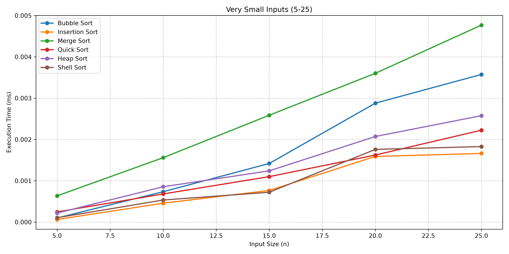
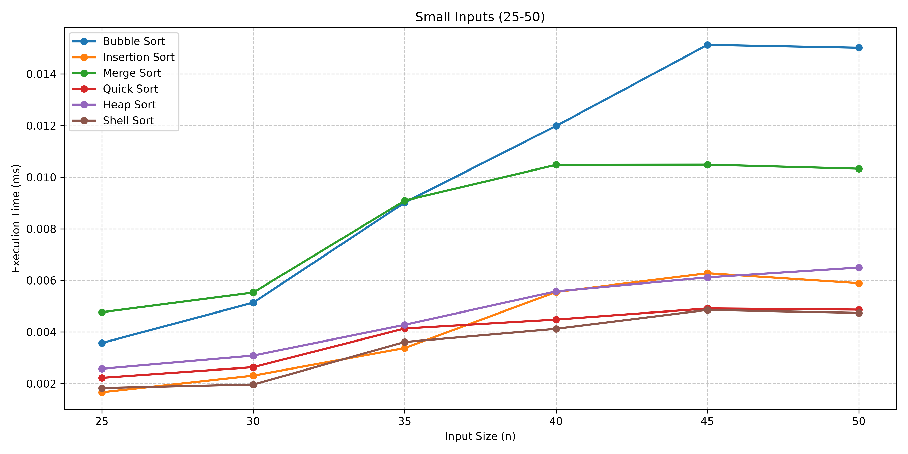
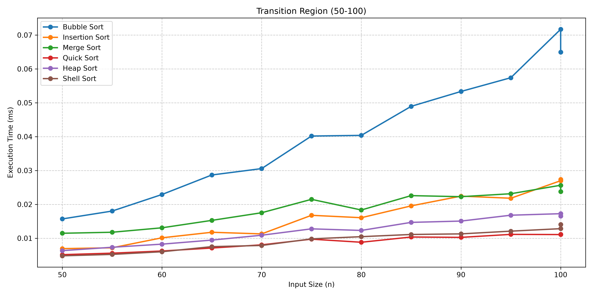
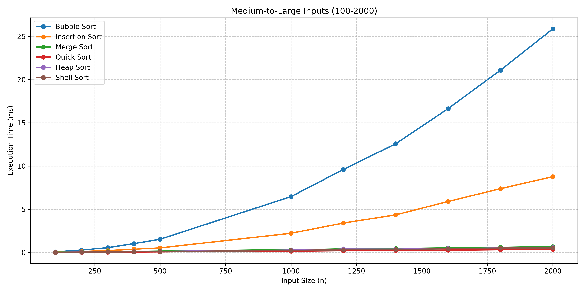
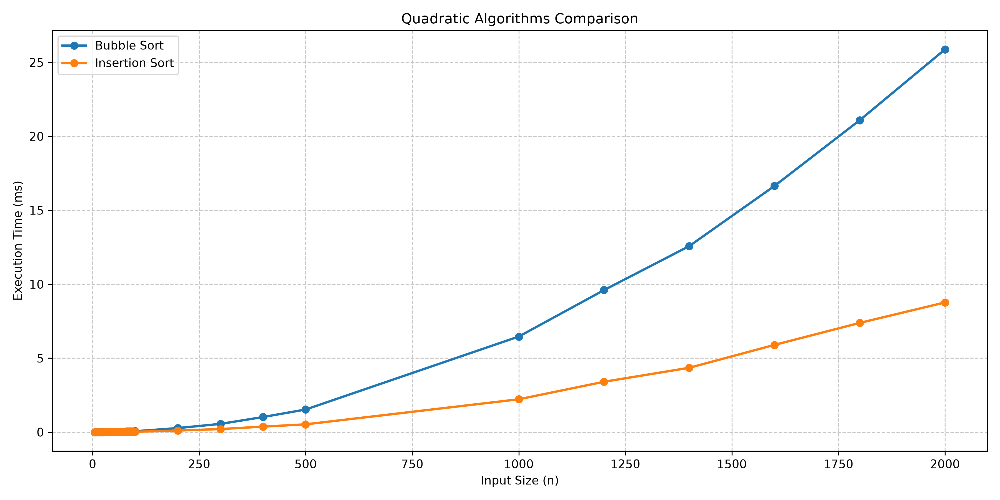
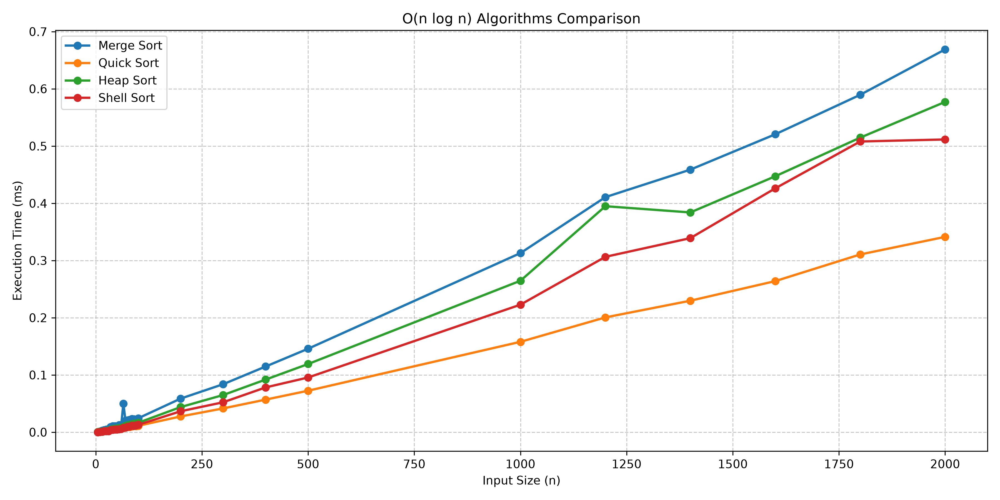
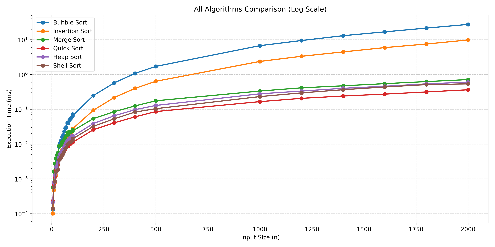

# Algorithms Sorting Benchmark


A C++ project for benchmarking and comparing classical sorting algorithms using a custom dynamic array implementation (`Vec`).

The project was developed as part of the **Algorithms I** course and focuses on practical performance analysis, complexity comparison, implementation quality, experimental evaluation, automated testing, and performance visualization.

---

## Overview

This project implements and evaluates six classical sorting algorithms using a custom dynamic array implementation (`Vec`).

The primary goal is to experimentally compare theoretical complexity analysis with real-world performance through systematic benchmarking. Each algorithm is executed on identical randomly generated datasets across multiple input sizes, and execution times are averaged over 100 runs to reduce measurement noise.

The project investigates:

- How algorithmic complexity affects scalability.
- The practical performance difference between O(n²) and O(n log n) algorithms.
- The impact of implementation details and constant factors on running time.
- The relationship between theoretical analysis and experimental results.

Algorithms evaluated:

- Bubble Sort
- Insertion Sort
- Merge Sort
- Quick Sort
- Heap Sort
- Shell Sort

The benchmark demonstrates how algorithm selection becomes increasingly important as input size grows.

---

## Features

### Implemented Sorting Algorithms

- Bubble Sort
- Insertion Sort
- Merge Sort
- Quick Sort
- Heap Sort
- Shell Sort

### Custom Data Structure

The project includes a custom dynamic array implementation named `Vec` featuring:

- Dynamic resizing
- Deep copy semantics
- Copy assignment operator
- Bounds-checked element access
- Iterator support (`begin()` / `end()`)
- Stream output operator
- Aggregate operations (`sum()`, `avg()`)
- Rotation and reversal utilities

### Benchmarking

- Random input generation
- High-resolution timing using `QueryPerformanceCounter()`
- Sorting correctness verification using `isSorted()`
- 100 benchmark repetitions per input size
- CSV export of benchmark results
- Automated graph generation

### Testing & Quality Assurance

- Catch2 unit testing framework
- CTest integration
- GitHub Actions Continuous Integration
- Automated verification of sorting correctness

---

## Complexity Summary

| Algorithm | Best Case | Average Case | Worst Case |
|-----------|-----------|-------------|------------|
| Bubble Sort | O(n) | O(n²) | O(n²) |
| Insertion Sort | O(n) | O(n²) | O(n²) |
| Merge Sort | O(n log n) | O(n log n) | O(n log n) |
| Quick Sort | O(n log n) | O(n log n) | O(n²) |
| Heap Sort | O(n log n) | O(n log n) | O(n log n) |
| Shell Sort | Approximately O(n log n) in practice | Approximately O(n^1.3–n^1.5) | O(n²) |
---

### Shell Sort Gap Sequence

The implementation uses Shell's original gap sequence:

```text
n/2, n/4, n/8, ..., 1
```

For example, when sorting 100 elements, the gap values are:

```text
50, 25, 12, 6, 3, 1
```

The sequence is generated using:

```cpp
for (int gap = n / 2; gap > 0; gap /= 2)
```

The choice of gap sequence has a significant impact on Shell Sort's performance.

Using the halving sequence:

- Moves elements long distances early in the sorting process.
- Reduces the amount of work required during the final insertion-sort pass.
- Performs much better than Bubble Sort and Insertion Sort.
- Produces practical performance close to O(n log n) for random data.
- Retains a theoretical worst-case complexity of O(n²).

More advanced gap sequences such as Hibbard's, Knuth's, or Sedgewick's sequences can improve both theoretical and experimental performance. The original Shell sequence was chosen because it is easy to understand and implement for educational purposes.

---

## Benchmark Methodology

For each benchmark size:

1. Generate a random input array.
2. Create identical copies of the input data.
3. Execute each sorting algorithm on the same data.
4. Repeat the benchmark **100 times**.
5. Calculate the average execution time.
6. Verify correctness using `isSorted(...)`.
7. Export results to CSV.

### Benchmark Input Sizes

#### Very Small Inputs

```text
5, 10, 15, 20, 25
```

#### Small Inputs

```text
30, 35, 40, 45, 50
```

#### Transition Region

```text
55, 60, 65, 70, 75, 80, 85, 90, 95, 100
```

#### Medium Inputs

```text
200, 300, 400, 500
```

#### Large Inputs

```text
1000, 1200, 1400, 1600, 1800, 2000
```

Benchmark results are exported to:

```text
data/data.csv
```

---

## Testing

Unit tests were implemented using the **Catch2** framework.

### Covered Functionality

The test suite verifies:

- Bubble Sort correctness
- Insertion Sort correctness
- Merge Sort correctness
- Quick Sort correctness
- Heap Sort correctness
- Shell Sort correctness
- Vector operations
- Sorted-order validation
- Size preservation after sorting

### Run Tests

```bash
ctest --test-dir build --output-on-failure
```

Example output:

```text
Start 1: AlgorithmsSortingBenchmarkTests
1/1 Test #1: AlgorithmsSortingBenchmarkTests ... Passed

100% tests passed out of 1
```

Although CTest reports a single executable, the executable internally contains multiple Catch2 test cases.

---

## Continuous Integration

The project uses **GitHub Actions** to automatically:

- Configure the project using CMake
- Build the benchmark application
- Build the test suite
- Execute all unit tests

on every push and pull request.

Workflow location:

```text
.github/workflows/ci.yml
```

---

## Example Results

### Measured Average Execution Times (ms)

| Input Size | Bubble Sort | Insertion Sort | Merge Sort | Quick Sort | Heap Sort | Shell Sort |
|------------|------------:|---------------:|-----------:|-----------:|----------:|-----------:|
| 100 | 0.0602 | 0.0222 | 0.0243 | 0.0112 | 0.0165 | 0.0128 |
| 1000 | 6.4617 | 2.2199 | 0.3129 | 0.1579 | 0.2646 | 0.2228 |
| 2000 | 25.8742 | 8.7669 | 0.6688 | 0.3413 | 0.5771 | 0.5115 |

The results clearly show the separation between quadratic algorithms and the more scalable O(n log n) algorithms as input size increases.

---

# Results and Analysis

The benchmark results were visualized using seven figures covering different input-size ranges and algorithm groups.

---

## Figure 1 – Very Small Inputs (5–25)



### Observations

- All algorithms perform similarly for very small input sizes.
- Constant factors dominate execution time.
- Complexity differences are not yet significant.
- Bubble Sort remains competitive because the datasets are extremely small.
- Quick Sort and Shell Sort already exhibit slightly lower execution times than the remaining algorithms.

---

## Figure 2 – Small Inputs (30–50)



### Observations

- Performance differences begin to emerge.
- Bubble Sort and Insertion Sort start growing faster than the remaining algorithms.
- Quick Sort consistently ranks among the fastest algorithms.
- Merge Sort experiences additional overhead caused by recursion and temporary storage.
- Shell Sort performs surprisingly well for this input range.

---

## Figure 3 – Transition Region (55–100)



### Observations

- The distinction between O(n²) and O(n log n) algorithms becomes increasingly visible.
- Bubble Sort and Insertion Sort begin diverging from the remaining algorithms.
- Quick Sort, Heap Sort, Merge Sort, and Shell Sort remain relatively close together.
- Complexity effects become more important than implementation overhead.
- This region marks the beginning of noticeable scalability differences.

---

## Figure 4 – Medium-to-Large Inputs (100–2000)



### Observations

- Algorithmic complexity becomes the dominant factor.
- Bubble Sort execution time increases dramatically.
- Insertion Sort remains significantly faster than Bubble Sort but still exhibits quadratic growth.
- The O(n log n) algorithms scale efficiently.
- Quick Sort consistently achieves the lowest execution times.
- The performance gap between quadratic and logarithmic algorithms widens rapidly as input size increases.

---

## Figure 5 – Quadratic Algorithms Comparison



### Observations

- Both algorithms exhibit the expected O(n²) growth.
- Insertion Sort consistently outperforms Bubble Sort.
- The performance difference becomes increasingly pronounced as input size grows.

At 2000 elements:

```text
Bubble Sort    : 25.8742 ms
Insertion Sort : 8.7669 ms
```

Insertion Sort is approximately:

```text
2.95× faster
```

than Bubble Sort despite sharing the same asymptotic complexity.

### Interpretation

Although Bubble Sort and Insertion Sort belong to the same complexity class, Insertion Sort performs fewer unnecessary swaps and therefore achieves substantially better practical performance.

---

## Figure 6 – O(n log n) Algorithms Comparison



### Observations

- All algorithms scale according to O(n log n) behavior.
- Quick Sort consistently achieves the best performance.
- Shell Sort remains surprisingly competitive.
- Heap Sort provides stable O(n log n) performance.
- Merge Sort exhibits predictable growth but incurs additional memory overhead.

### Performance at 2000 Elements

```text
Quick Sort : 0.3413 ms
Shell Sort : 0.5115 ms
Heap Sort  : 0.5771 ms
Merge Sort : 0.6688 ms
```

### Interpretation

Quick Sort benefits from excellent cache locality and low constant factors on randomly generated input, explaining its superior performance.

### Why Shell Sort Performs Well

The strong performance of Shell Sort is largely explained by the gap sequence used in this implementation.

Unlike Insertion Sort, which only compares neighboring elements, Shell Sort allows elements to move long distances through the array during the early stages of the algorithm.

Gap sequence used:

```text
n/2, n/4, n/8, ..., 1
```

At 2000 elements:

```text
Shell Sort : 0.5115 ms
Heap Sort  : 0.5771 ms
Merge Sort : 0.6688 ms
```

Despite having weaker theoretical guarantees than Merge Sort and Heap Sort, Shell Sort outperformed both on the tested random datasets.

This demonstrates that practical performance depends not only on asymptotic complexity but also on implementation details, memory access patterns, and constant factors.

---

## Figure 7 – Full Comparison (Logarithmic Scale)



### Observations

- The logarithmic scaleithms.
- The four efficient algorithms cluster together and remain highly scalable.
- The gap between Bubble Sort and Quick Sort becomes striking at large input sizes.

### Performance at 2000 Elements

```text
Bubble Sort : 25.8742 ms
Quick Sort  : 0.3413 ms
```

Bubble Sort is approximately:

```text
75.8× slower
```

than Quick Sort.

### Interpretation

The logarithmic graph provides the clearest overall picture of scalability and confirms the theoretical complexity analysis.

---

## Key Findings

### Fastest Algorithm

**Quick Sort** achieved the best overall performance across all tested input sizes.

### Slowest Algorithm

**Bubble Sort** consistently produced the highest execution times.

### Best Quadratic Algorithm

**Insertion Sort** significantly outperformed Bubble Sort despite sharing the same O(n²) complexity class.

### Most Scalable Algorithms

The algorithms exhibiting O(n log n) growth:

- Quick Sort
- Shell Sort
- Heap Sort
- Merge Sort

all scaled effectively throughout the benchmark range.

### Experimental Validation

The benchmark results closely match theoretical expectations:

- Bubble Sort and Insertion Sort exhibit quadratic growth.
- Merge Sort, Heap Sort, and Quick Sort exhibit O(n log n) growth.
- Shell Sort performs substantially better than quadratic algorithms and remains competitive with the O(n log n) algorithms.

---

## Conclusion

This project successfully implemented and benchmarked six classical sorting algorithms using a custom dynamic array implementation.

The measured execution times closely match the theoretical complexity classes studied in Algorithm Design and Analysis. Bubble Sort and Insertion Sort become increasingly inefficient as input size grows, while Merge Sort, Heap Sort, Quick Sort, and Shell Sort scale significantly more effectively.

Among all tested algorithms, **Quick Sort achieved the best overall performance**, completing the 2000-element benchmark in only **0.3413 ms**. In comparison, **Bubble Sort required 25.8742 ms**, making it approximately **76 times slower** on the same input.

Insertion Sort consistently outperformed Bubble Sort despite both algorithms belonging to the O(n²) complexity class, highlighting the importance of implementation details and constant factors in practical performance.

Overall, the benchmark demonstrates how asymptotic complexity predicts long-term scalability while practical measurements reveal the real-world impact of algorithm design choices.

---

## Project Structure

```text
Algorithms-Sorting-Benchmark
│
├── .github/
│   └── workflows/
│       └── ci.yml
│
├── data/
│   ├── data.csv
│  
│
├── report/
|   |── graph.py
│   ├── figure1_very_small_inputs.png
│   ├── figure2_small_inputs.png
│   ├── figure3_transition_region.png
│   ├── figure4_medium_large_inputs.png
│   ├── figure5_quadratic_algorithms.png
│   ├── figure6_nlogn_algorithms.png
│   └── figure7_full_comparison_log.png
│
├── external/
│   └── catch.hpp
│
├── src/
│   ├── main.cpp
│   ├── Vec.cpp
│   ├── Vec.h
│   ├── sorts.cpp
│   └── sorts.h
│
├── tests/
│   └── AlgorithmsSortingBenchmark_TDD.cpp
│
├── CMakeLists.txt
└── README.md
```

---

## Setup and Usage

### Clone the Repository

```bash
git clone https://github.com/YOUR_USERNAME/Algorithms-Sorting-Benchmark.git
cd Algorithms-Sorting-Benchmark
```

### Configure

```bash
cmake -S . -B build
```

### Build

```bash
cmake --build build --config Release
```

### Run Tests

```bash
ctest --test-dir build --output-on-failure
```

Example output:

```text
Start 1: AlgorithmsSortingBenchmarkTests
1/1 Test #1: AlgorithmsSortingBenchmarkTests ... Passed

100% tests passed out of 1
```

### Run Benchmark

```bash
build/Release/benchmark.exe
```

### Benchmark Output

Results are written automatically to:

```text
data/data.csv
```

### Generate Graphs

Install dependencies:

```bash
pip install pandas matplotlib
```

Generate all graphs:

```bash
python data/plot_results.py
```

Generated files:

```text
report/
├── figure1_very_small_inputs.png
├── figure2_small_inputs.png
├── figure3_transition_region.png
├── figure4_medium_large_inputs.png
├── figure5_quadratic_algorithms.png
├── figure6_nlogn_algorithms.png
└── figure7_full_comparison_log.png
```

---

## Technologies

- C++17
- CMake
- Catch2
- CTest
- GitHub Actions
- Python
- Pandas
- Matplotlib
- Git

---

## Future Improvements

- Comparison against `std::sort`
- Statistical confidence intervals
- Additional input distributions:
  - Sorted arrays
  - Reverse-sorted arrays
  - Nearly sorted arrays
  - Duplicate-heavy arrays
- Cross-platform benchmarking using `std::chrono`
- Evaluation of Hibbard, Knuth, and Sedgewick Shell Sort gap sequences
- Performance analysis on larger datasets

---

## Author

**Desire Roslin Dziele**  
Computer Science Student  
University of Łódź