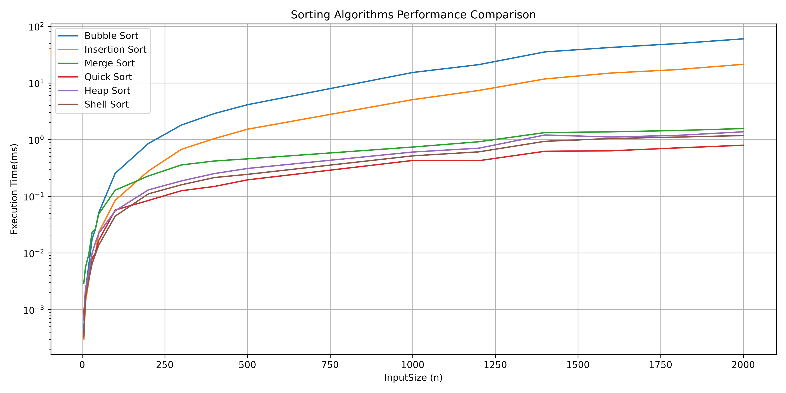
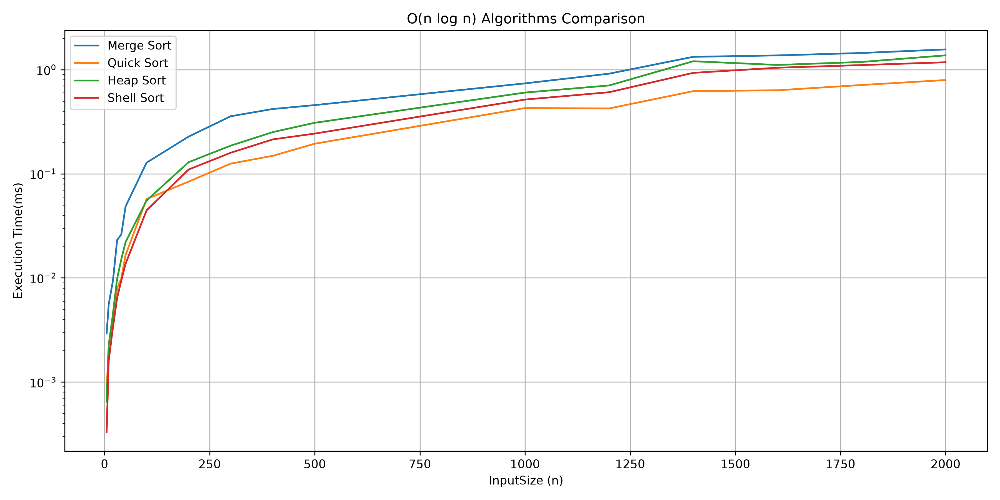
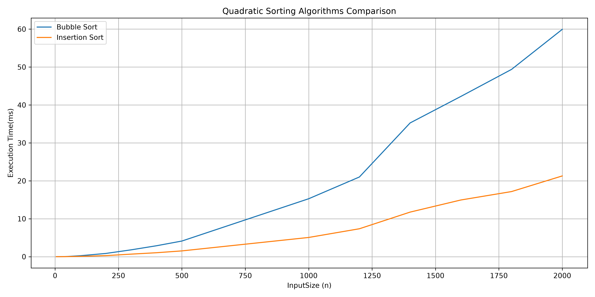

# Algorithms Sorting Benchmark

A C++ project for benchmarking and comparing classical sorting algorithms using a custom dynamic array implementation (`Vec`).

The project was developed as part of an Algorithms course and focuses on practical performance analysis, complexity comparison, and experimental evaluation of sorting techniques.

---

## Features

### Sorting Algorithms

- Bubble Sort
- Insertion Sort
- Merge Sort
- Quick Sort
- Heap Sort
- Shell Sort

### Custom Data Structure

- `Vec` dynamic array implementation
- Dynamic resizing
- Deep copy semantics
- Bounds-checked element access
- Copy assignment operator
- Stream output operator
- Iterator support (`begin()` / `end()`)

### Benchmarking

- Random input generation
- High-resolution timing using `QueryPerformanceCounter`
- Sorting correctness verification
- 20-run averaged measurements
- CSV export
- Automated graph generation

---

## Complexity Summary

| Algorithm | Best Case | Average Case | Worst Case |
|------------|------------|------------|------------|
| Bubble Sort | O(n) | O(n²) | O(n²) |
| Insertion Sort | O(n) | O(n²) | O(n²) |
| Merge Sort | O(n log n) | O(n log n) | O(n log n) |
| Quick Sort | O(n log n) | O(n log n) | O(n²) |
| Heap Sort | O(n log n) | O(n log n) | O(n log n) |
| Shell Sort | Depends on gap sequence | Typically better than O(n²) | Depends on gap sequence |

---

## Benchmark Methodology

For each input size:

1. Generate a random input array.
2. Create identical copies of the input.
3. Execute each sorting algorithm on the same data.
4. Repeat the benchmark 20 times.
5. Compute the average execution time.
6. Verify correctness using `isSorted(...)`.
7. Export results to CSV.

Input sizes were selected to match the assignment requirements:

### Small Inputs

```text
5, 10, 20, 30, 40, 50
```

### Larger Inputs

```text
100, 200, 300, 400, 500
```

### Superlarge Inputs

```text
1000, 1200, 1400, 1600, 1800, 2000
```

Benchmark results are exported to:

```text
data/data.csv
```

---

## Example Results

```text
InputSize    Bubble   Insertion   Merge   Quick   Heap   Shell

100          0.180    0.070       0.089   0.031   0.053   0.046
1000         15.453   5.450       0.792   0.402   0.666   0.549
2000         56.838   19.534      1.513   0.741   1.266   1.129
```

---

## Results

### All Algorithms



### Efficient Algorithms (Merge, Quick, Heap, Shell)



### Quadratic Algorithms (Bubble, Insertion)



---

## Graph Generation

Benchmark results can be visualized using:

- Pandas
- Matplotlib

Generate graphs with:

```bash
python data/plot_results.py
```

Generated figures:

```text
graph_all_algorithms.png
graph_fast_algorithms.png
graph_quadratic_algorithms.png
```

---

## Observations

Experimental results are consistent with theoretical complexity analysis.

- Bubble Sort is the slowest algorithm for larger inputs.
- Insertion Sort performs better than Bubble Sort but remains quadratic.
- Merge Sort demonstrates stable O(n log n) growth.
- Quick Sort is consistently the fastest algorithm on randomly generated input.
- Heap Sort guarantees O(n log n) performance while sorting in-place.
- Shell Sort significantly outperforms quadratic algorithms and remains competitive with Heap Sort.

---

## Conclusion

This project successfully implemented and benchmarked six classical sorting algorithms using a custom dynamic array implementation (`Vec`).

The measured running times closely match the theoretical complexity classes studied in Algorithm Design and Analysis. Bubble Sort and Insertion Sort become increasingly inefficient as input size grows, while Merge Sort, Quick Sort, Heap Sort, and Shell Sort scale much more effectively.

Among all tested algorithms, Quick Sort achieved the best overall performance on randomly generated datasets. Heap Sort and Merge Sort demonstrated the expected O(n log n) behavior, while Shell Sort provided surprisingly competitive results despite its dependence on the chosen gap sequence.

The benchmark clearly demonstrates the practical impact of algorithmic complexity and highlights the importance of selecting efficient algorithms for large data sets.

---

## Project Structure

```text
Algorithms-Sorting-Benchmark
│
├── data/
│   ├── data.csv
│   └── plot_results.py
│
├── report/
│   ├── graph_all_algorithms.png
│   ├── graph_fast_algorithms.png
│   └── graph_quadratic_algorithms.png
│
├── src/
│   ├── main.cpp
│   ├── Vec.cpp
│   ├── Vec.h
│   ├── sorts.cpp
│   └── sorts.h
│
└── README.md
```

---

## Build

Compile using GCC:

```bash
g++ src/main.cpp src/sorts.cpp src/Vec.cpp -o benchmark
```

Run:

```bash
./benchmark
```

Windows:

```cmd
benchmark.exe
```

---

## Technologies

- C++17
- GCC / MinGW
- Git
- Python
- Pandas
- Matplotlib

---

## Future Improvements

- Additional benchmark repetitions and statistical analysis
- Benchmark comparison with `std::sort`
- Additional input distributions:
  - Sorted arrays
  - Reverse-sorted arrays
  - Nearly sorted arrays
  - Duplicate-heavy arrays
- Cross-platform timing using `std::chrono`
- Automated testing framework
- Comparison of different Shell Sort gap sequences

---

## Author

**Desire Roslin Dziele**  
Computer Science Student
